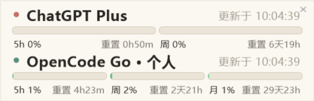

# Milkman 🥛

> ChatGPT Plus / OpenCode Go 用量浮窗 —— 不打开网页也能看到还剩多少额度



Windows 专用的单文件 WinForms 常驻浮窗：无边框、半透明、屏幕顶部吸附，鼠标靠近展开，双击钉住。整个程序只有一个 [Main.cs](Main.cs)，用系统自带的 `csc.exe` 编译，不依赖 SDK 或第三方包。

## 功能

- **ChatGPT Plus**：按服务端返回的窗口（5h / 周 / 代码审查）分段展示；服务端暂时不返回 5h 时显示 `5h ∞`
- **OpenCode Go**：支持多个账户；每个账户 5h / 周 / 月三条用量，账户级计数与其他设备一致
- 屏幕顶部吸附 + 缓出动画 + 双击 Pin
- 固定开机自启；窗口位置与吸附状态持久化
- 独立刷新：ChatGPT 与每个 Go 账户互不等待；失败只暂停自身并保留旧数据，点对应“重试”恢复
- 原生置顶丢失后自动恢复，不抢前台焦点

## 数据源

| 订阅 | 端点 | 凭据 |
|---|---|---|
| ChatGPT / Codex | `chatgpt.com/backend-api/wham/usage`（非官方） | `%USERPROFILE%\.codex\auth.json` 的 OAuth token，401 时自动刷新并写回 |
| OpenCode Go | `opencode.ai/zen/go/v1/usage` | `OpenCodeAccounts[].Key`（Console API key）；回退 OpenCode 1 `auth.json` 里的 `opencode-go.key` |

## 系统要求

- Windows 10 / 11
- .NET Framework 4.x（系统自带，无需安装 SDK）

## 编译与运行

```bat
build.bat
```

产物为 `%LOCALAPPDATA%\Milkman\Milkman.exe`，双击即可运行。程序每次启动都会登记开机自启。

在 WSL 中手动编译（`/out` 必须是 Windows 本地路径，不能是 `\\wsl.localhost\...`）：

```bash
/mnt/c/Windows/Microsoft.NET/Framework64/v4.0.30319/csc.exe /nologo /target:winexe /platform:anycpu \
  /r:System.dll /r:System.Core.dll /r:System.Drawing.dll /r:System.Windows.Forms.dll /r:System.Web.Extensions.dll \
  /codepage:65001 /out:"C:\path\to\Milkman.exe" "$(wslpath -w Main.cs)"
```

## 配置

`%LOCALAPPDATA%\Milkman\config.json`：

```json
{
  "X": 2224,
  "Y": -2160,
  "Docked": true,
  "RefreshSeconds": 60,
  "OpenCodeAccounts": [
    { "Name": "个人", "Key": "oc_sk_...", "AuthPath": "" }
  ]
}
```

- `RefreshSeconds`：刷新间隔，默认 60 秒
- `OpenCodeAccounts`：账户列表，每项在浮窗中占一行；留空数组 `[]` 会隐藏 OpenCode Go 区块
- `Name`：显示名称
- `Key`：OpenCode Go 的 API key（Console → Account › Personal API keys，`oc_sk_` 开头）。OpenCode 2 把凭据存进本地数据库、不再更新 `auth.json`，所以推荐直接填这里
- `AuthPath`：OpenCode 1 的 `auth.json` 路径；`Key` 为空时从中读取 `opencode-go.key`
- `X` / `Y` / `Docked`：窗口位置与吸附状态，由程序自动维护

首次运行且没有配置账户时，程序会探测本机 OpenCode 1 的 `%LOCALAPPDATA%\opencode\auth.json` 和 `~/.local/share/opencode/auth.json`；找不到就隐藏 Go 区块，填好配置后自动显示。

## 使用

- 鼠标移到屏幕顶部提示条上展开，移开自动收起
- 拖到屏幕顶吸附；往下拖离取消吸附
- 吸附状态下双击切换「钉住」，钉住后不自动收起
- 右上角 `✕` 退出程序
- 前台是全屏视频/游戏时不自动弹出

## 维护

- **换 Go key**：在 Console 重新创建后更新 `config.json` 里的 `Key`，下一轮刷新生效
- **OpenCode 1 用户**：把 `AuthPath` 指向 `auth.json` 即可，不需要 `Key`
- **ChatGPT token**：过期后自动用 `refresh_token` 刷新并写回 `auth.json`

## 已知限制

- `wham/usage` 是非官方端点，可能随 OpenAI 调整
- OpenCode Go 用量接口没有公开文档，字段变化时可能需要适配
- `config.json` 中的 key 为明文（与 OpenCode 1 的 `auth.json` 相同），不要提交到仓库或分享
- 仅支持 Windows

## 参考项目

- [DeepSeekTimeline](https://github.com/Jerry2262/DeepSeekTimeline) — 版式与交互模板
- [openusage](https://github.com/robinebers/openusage) — Codex 凭据刷新与 Go 用量取数参考

## License

[MIT](LICENSE)
